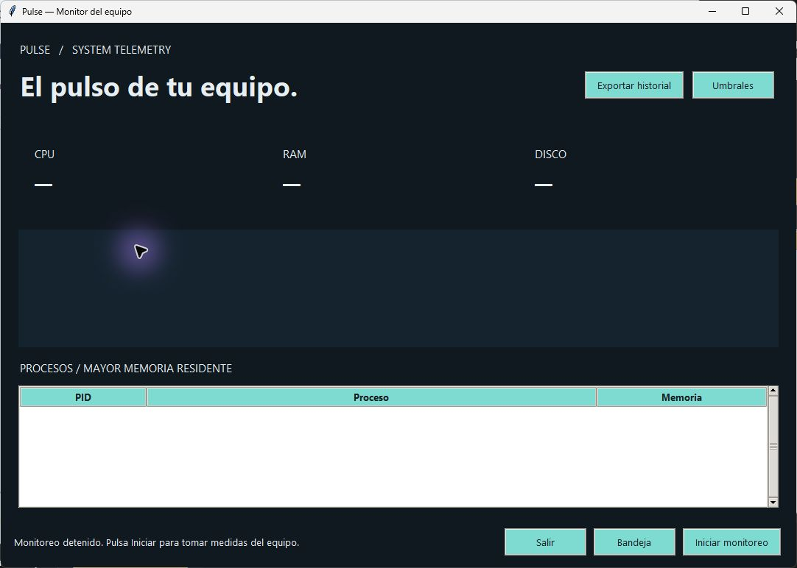

# Pulse

A native Windows resource monitor with history, threshold alerts and a system tray.

[](https://github.com/MIGUEL-MOSCOSO-DEV/pulse/actions/workflows/ci.yml) · [Descargas](https://github.com/MIGUEL-MOSCOSO-DEV/pulse/releases/latest) · [MIT](LICENSE)

Un monitor de recursos para Windows, con historial local y acceso desde la bandeja del sistema. No envía métricas a un servidor.



## Qué incluye

- CPU, RAM y ocupación del disco del perfil, con muestreo cada dos segundos.
- Gráfico de las últimas 120 muestras y hasta 50000 registros persistentes.
- Procesos ordenados por memoria residente, sin terminar procesos ni modificar sus prioridades.
- Umbrales configurables, aviso en el panel, notificación desde la bandeja y exportación CSV.

## Descargar para Windows

En [Releases](https://github.com/MIGUEL-MOSCOSO-DEV/pulse/releases/latest) encontrarás Pulse.exe y su archivo SHA256SUMS.txt. Es una aplicación portable para Windows 10/11 de 64 bits: no necesita instalar Python ni permisos de administrador. Abre el ejecutable para iniciar. Los ejecutables no tienen firma digital.

## Ejecutar desde el código

Necesitas Python 3.11 o superior con Tkinter. Crea un entorno virtual para mantener las dependencias separadas.

```sh
git clone https://github.com/MIGUEL-MOSCOSO-DEV/pulse.git
cd pulse
python -m venv .venv
```

En Windows:

```powershell
.venv\Scripts\python.exe -m pip install .
.venv\Scripts\python.exe launch.py
```

En Linux o macOS puedes usar .venv/bin/python. Tkinter debe estar disponible en tu instalación de Python; la revisión visual y los ejecutables publicados corresponden a Windows.

## Uso

Pulsa Iniciar monitoreo para comenzar. Pausar detiene nuevas muestras y conserva lo medido. Umbrales ajusta el porcentaje de CPU, RAM y disco que produce un aviso. Bandeja oculta la ventana; desde el icono puedes mostrarla o salir. Cerrar la ventana o pulsar Salir termina el programa.

## Datos y privacidad

La instalación comienza sin registros de demostración. Los datos locales se guardan en ~/.pulse (la carpeta de tu usuario). Puedes cambiar esa ubicación con la variable PULSE_HOME. metrics.sqlite guarda porcentajes y fechas; los nombres de procesos no se persisten.

## Alcance actual

Muestra el disco donde está la carpeta del usuario, no todos los volúmenes. Conserva las últimas 50000 muestras; los nombres de procesos solo se muestran durante la sesión. Las alertas de cada métrica tienen dos minutos de espera entre avisos. Los umbrales vuelven a sus valores iniciales al reiniciar. Las notificaciones dependen de la configuración de Windows y del soporte de la bandeja.

## Desarrollo y pruebas

```sh
python -m pip install . -r requirements-dev.txt
python -m ruff check .
python -m ruff format --check .
python -m unittest discover -s tests -v
```

Las pruebas usan directorios y datos temporales. GitHub Actions verifica formato y pruebas en Windows y Linux y construye un ejecutable de Windows como artefacto del workflow. No hay una aplicación web ni un servidor remoto requerido.

## Generar el ejecutable

Desde Windows, con las dependencias de desarrollo instaladas:

```sh
python -m PyInstaller --noconfirm --clean --onefile --windowed --name Pulse launch.py
```

El resultado queda en dist/Pulse.exe. PyInstaller construye para el sistema donde se ejecuta; para generar Windows necesitas construir desde Windows. Los archivos de compilación y los datos locales se excluyen de Git.

## Estructura

metrics.py obtiene datos con psutil y evalúa alertas; database.py controla las conexiones; app.py dibuja el historial y gestiona la bandeja.

## Contribuir

Abre un issue con el sistema operativo, la versión y los pasos para reproducir el problema. No incluyas archivos privados, contraseñas ni bases reales. Para cambiar reglas de negocio, añade una prueba que describa el caso.

Creado por [Miguel Moscoso](https://github.com/MIGUEL-MOSCOSO-DEV). Licencia MIT.
